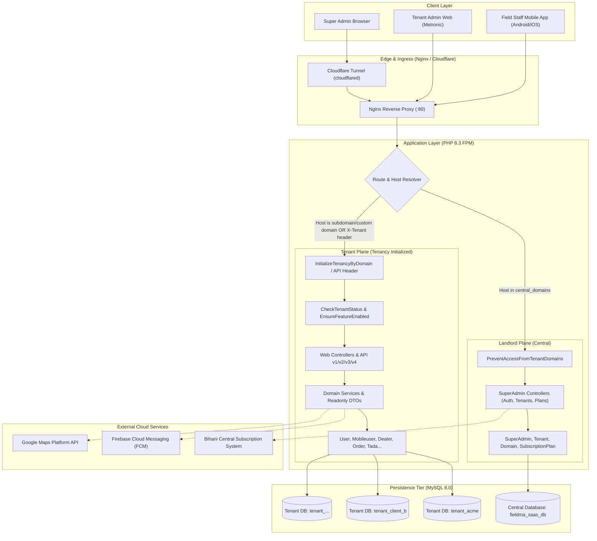
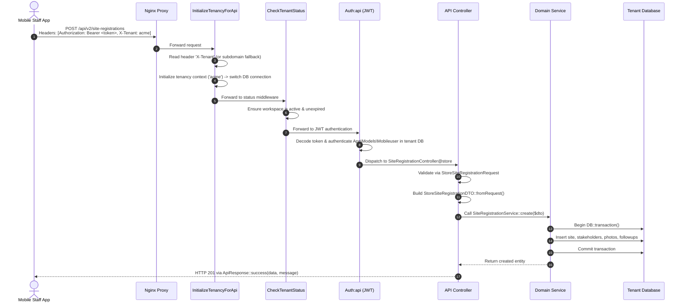

# FieldMA 2.0 SaaS — System Architecture & Design

## 1. High-Level System Architecture

FieldMA 2.0 is designed as an isolated **Database-per-Tenant Multi-Tenant SaaS Platform** built on the Laravel framework. The system is split into two primary operational tiers:

1. **Central Landlord Control Plane**: Manages subscription plans, tenant provisioning, lifecycle status, custom domains, database migrations, and administrative analytics.
2. **Tenant Workspaces (Tenancy)**: Autonomous enterprise environments with completely isolated relational databases (`tenant_{slug}`), bespoke branding (logos, favicons, primary theme colors), user bases, and localized business logic.



---

## 2. Directory Structure Breakdown

```text
fieldma-2.o-SaaS-new/
├── app/
│   ├── Console/
│   │   ├── Commands/
│   │   │   ├── AutoCheckout.php            # Automated end-of-day mobile staff checkout job
│   │   │   └── ImportExistingTenantCommand.php # Command to onboard legacy single-tenant DBs
│   ├── DTO/                                # Data Transfer Objects layer
│   │   └── v2/siteRegistration/            # Immutable strictly-typed DTOs (e.g. StoreSiteRegistrationDTO)
│   ├── Enums/                              # PHP 8.1+ Enums
│   │   └── v2/siteRegistration/FollowUpType.php
│   ├── Exceptions/
│   │   └── Handler.php                     # Centralized exception interception
│   ├── Exports/                            # 20+ Excel export classes (Maatwebsite Excel)
│   ├── Http/
│   │   ├── Controllers/
│   │   │   ├── API/                        # Mobile endpoints (v1, v2, v3, v4)
│   │   │   ├── SuperAdmin/                 # Central console controllers (TenantController, SubscriptionPlanController)
│   │   │   ├── Tenant/                     # Tenant settings & self-service branding
│   │   │   └── *.php                       # Tenant web controllers (Order, Tada, Attendance, Dealer, etc.)
│   │   ├── Middleware/                     # Tenancy, JWT auth, Spatie permissions, feature gating
│   │   ├── Requests/                       # Form validation requests
│   │   ├── Resources/                      # Eloquent API resources
│   │   ├── Responses/                      # Standardized ApiResponse trait
│   │   └── Kernel.php                      # Global & route middleware registries
│   ├── Imports/                            # Bulk Excel import classes (DealerImport, ProductImport)
│   ├── Models/                             # 70+ Eloquent models
│   │   ├── Tenant.php                      # Stancl Tenancy model with database & domain concerns
│   │   ├── SuperAdmin.php                  # Central administrative user
│   │   ├── SubscriptionPlan.php            # SaaS pricing and feature toggle catalog
│   │   └── *.php                           # Tenant business models (Mobileuser, Order, TadaEntry, etc.)
│   ├── Policies/                           # Spatie permission & resource authorization policies
│   ├── Providers/
│   │   ├── AppServiceProvider.php
│   │   ├── RouteServiceProvider.php
│   │   └── TenancyServiceProvider.php      # Stancl lifecycle pipelines (creation, migration, seeding)
│   ├── Services/                           # Business logic domain services
│   │   ├── API/TeamMemberService.php       # Hierarchy calculation & team attendance aggregation
│   │   └── v2/siteRegistration/            # Modern pipeline service for site tracking
│   ├── Traits/
│   │   ├── CustomNepaliCalendarConverter.php # Nepali BS <-> Gregorian AD calendar conversion
│   │   ├── FCM.php                         # Firebase Cloud Messaging push dispatch
│   │   └── Geocodable.php                  # Lat/Lng spatial calculations
│   ├── Utilities/                          # Global helpers and system counters
│   └── helpers.php                         # Global multi-tenant helper functions
├── config/
│   ├── tenancy.php                         # Stancl Tenancy configuration (database-per-tenant, bootstrappers)
│   ├── auth.php                            # Guards: web (User), super_admin (SuperAdmin), api (JWT Mobileuser)
│   └── database.php                        # Central & tenant database connections
├── database/
│   ├── migrations/                         # Central / Landlord migrations (super_admins, tenants, plans, domains)
│   │   └── tenant/                         # 119 migrations executed dynamically for each tenant database
│   └── seeders/
│       ├── CentralDatabaseSeeder.php       # Seeds super admins and subscription plans
│       └── TenantDatabaseSeeder.php        # Seeds default tenant roles, permissions, issue types
├── docs/                                   # Domain documentation (dynamic features, team hierarchy, unlisted dealers)
├── public/                                 # Web entrypoint, static assets, compiled bundles
├── resources/
│   ├── css/                                # Tailwind and custom stylesheets
│   ├── js/                                 # Javascript and chart renderers
│   └── views/
│       ├── super-admin/                    # Tailwind CSS Super Admin Console (plans, tenants, dashboard)
│       ├── dashboards/                     # Metronic Layout 5 Tenant Portal
│       ├── errors/                         # Tenant error screens (tenant-suspended, tenant-expired)
│       └── tenant/settings/                # Tenant self-service branding editor
├── routes/
│   ├── web.php                             # Central domain routes (Super Admin auth, CRUD, maintenance)
│   ├── tenant.php                          # Tenancy bootstrap wrapper routes
│   ├── tenant_web.php                      # All tenant web portal routes (authenticated via guard 'web')
│   ├── api.php                             # Core mobile API routes (authenticated via guard 'api' / JWT)
│   └── v2/, v3/, v4/                       # Versioned mobile API routes
├── storage/                                # Logs, compiled views, tenant dynamic branding assets
├── docker-compose.yml                      # Full containerized stack definition
├── Dockerfile                              # Multi-stage PHP 8.3 Alpine build
├── nginx.conf                              # Nginx server block with multi-domain & CORS support
└── tailwind.config.js                      # Custom Tailwind theme tokens for Super Admin console
```

---

## 3. Request Lifecycle & Tenancy Data Flow

### 3.1 Central Domain Web Request Flow
When a super administrator accesses `http://manojshrestha239.com.np/super-admin` or `http://localhost/super-admin`:

```
1. Client Browser
       │ (Request to central domain)
       ▼
2. Nginx Reverse Proxy
       │ (Forwards to app:9000 with SCRIPT_FILENAME)
       ▼
3. HTTP Kernel (App\Http\Kernel)
       │ (Applies global middleware: TrustProxies, TrimStrings, etc.)
       ▼
4. RouteServiceProvider & TenancyServiceProvider
       │ (Detects host matches config('tenancy.central_domains'))
       │ (Loads routes/web.php; Tenancy is NOT initialized)
       ▼
5. SuperAdmin Auth Middleware ('auth:super_admin')
       │ (Validates session against App\Models\SuperAdmin in Central DB)
       ▼
6. Controller (e.g. SuperAdmin\TenantController)
       │ (Reads/Writes directly to Central Database fieldma_saas_db)
       ▼
7. Blade View (resources/views/super-admin/**)
       │ (Rendered with modern Tailwind CSS theme)
       ▼
8. Response returned to Client
```

### 3.2 Tenant Web Portal Request Flow
When a client organization accesses `http://acme.manojshrestha239.com.np/dashboard`:

```
1. Client Browser
       │ (Request to tenant subdomain)
       ▼
2. Nginx Reverse Proxy
       ▼
3. HTTP Kernel & TenancyServiceProvider Priority Middleware
       │
       ▼
4. InitializeTenancyByDomain (Stancl\Tenancy\Middleware)
       │ - Extracts host 'acme.manojshrestha239.com.np'
       │ - Looks up domain in domains table (Central DB)
       │ - Resolves Tenant model (id: 'acme')
       │ - Executes Bootstrappers:
       │     * DatabaseTenancyBootstrapper: Switches DB connection to 'tenant_acme'
       │     * CacheTenancyBootstrapper: Applies 'tenant_acme' cache tag
       │     * FilesystemTenancyBootstrapper: Suffices local/public disks
       ▼
5. CheckTenantStatus Middleware
       │ - Verifies tenant->status !== 'suspended'
       │ - Checks if trial or plan has expired (isExpired())
       │ - If expired/suspended -> aborts with HTTP 403 and specialized view
       ▼
6. Tenant Web Route Group ('web' + 'auth' + 'user.status')
       │ - Authenticates session using App\Models\User from 'tenant_acme' database
       │ - Validates permissions via Spatie Laravel-Permission
       ▼
7. Tenant Controller (e.g. OrderController, TadaReportController)
       │ - Executes queries against 'tenant_acme' database
       ▼
8. Blade Layout (resources/views/dashboards/partials/head.blade.php)
       │ - Dynamically injects tenant logo, favicon, and primary theme color:
       │   :root { --primary-theme-color: {{ tenant()->getThemeColor() }}; }
       ▼
9. Response returned to Client
```

### 3.3 Mobile API Request Flow (v1, v2, v3, v4)
Mobile users interact with endpoints like `/api/v2/site-registrations` or `/api/order`:



---

## 4. Database Architecture & Schema Isolation

### 4.1 Central Database (`fieldma_saas_db`)
The central database contains exclusively landlord-level data:
- `super_admins`: Platform master administrator accounts (name, email, password, remember_token).
- `tenants`: Core tenant records with columns:
  - `id` (string slug, e.g., `acme`)
  - `company_name`, `slug`, `email`, `phone`, `vat_number`, `address`
  - `status` (`active`, `trial`, `suspended`, `inactive`)
  - `subscription_plan_id` (foreign key to `subscription_plans.id`)
  - `trial_ends_at`, `plan_ends_at`
  - `data` (JSON store holding dynamic branding like `theme_color`, `fcm_topic`, `logo_url`, `favicon_url`, `feature_overrides`)
- `domains`: Domain mapping table linking subdomains and custom domains to `tenant_id`.
- `subscription_plans`: Pricing tiers (`starter`, `professional`, `enterprise`) storing:
  - `price`, `billing_interval`, `max_mobile_users`, `max_admin_users`
  - `features` (JSON key-value feature toggles: `attendance`, `order_booking`, `tada`, `stock_management`, etc.)
- `cache`, `telescope_entries`: System performance and diagnostics tracking.

### 4.2 Tenant Database (`tenant_{slug}`)
Every tenant receives a completely isolated database created upon provisioning. The schema comprises 119 migrations covering:
- **Identity & Access**: `users` (web portal admins), `mobileusers` (field force), `roles`, `permissions`, `model_has_roles`, `mobileuser_teams`.
- **Territories & Dealers**: `areas`, `subareas`, `assignareas`, `dealers`, `dealer_user_info`, `unlisted_dealers`.
- **Catalogs & Products**: `categories`, `products`, `sizes`, `product_size`, `producimages`, `schemes`.
- **Transactions & Fulfillment**: `orders`, `orderitems`, `carts`, `challans`, `payments`, `denominations`, `denominationpoints`.
- **Field Operations**: `attendances`, `locations`, `sessions`, `schedulevisits`, `repeateschedules`, `auto_checkouts`, `device_logs`.
- **Site Registration Pipeline**: `site_registration_v2_s`, `contractors`, `site_products`, `site_follow_ups`, `site_photo_v2_s`, `site_stage_logs`.
- **TADA Expense Management**: `tada_entries`, `tada_dealer_visits`, `tada_dealer_expenses`, `tada_other_expenses`, `tada_images`, `tada_authorized_users`, `tada_expense_authorized_users`.
- **Inventory & Manufacturing**: `raw_materials`, `raw_purchases`, `raw_inventory`, `product_dealers`, `product_stock`, `dealer_stocks`, `stock_transactions`.

---

## 5. External Integrations & Infrastructure

### 5.1 Firebase Cloud Messaging (FCM)
- Push notifications are delivered using the `FCM` trait (`App\Traits\FCM`).
- Used for:
  - Order status updates and collection alerts.
  - Team check-in / check-out alerts dispatched to senior managers.
  - End-of-day auto-checkout warnings.
  - Broadcast administrative notices to all staff on topic `{tenant_slug}_fieldMA_allUser`.

### 5.2 Cloudflare Tunnel (`cloudflared`)
- Secure zero-trust public ingress routing incoming wildcards (`*.manojshrestha239.com.np`) without exposing local database or application ports directly to the internet.
- Controlled via `CLOUDFLARED_TOKEN` in `.env`.

### 5.3 Nepali Date & Calendar Converter
- Dual calendar support enables companies in Nepal to operate on Bikram Sambat (BS) for official tax and reporting purposes while maintaining standard UTC/Gregorian database indexing.
- Seamless conversion handled via `CustomNepaliCalendarConverter` and `Nepali_Calendar`.

### 5.4 Caching & Background Queues
- **Tenancy-Aware Cache**: `CacheTenancyBootstrapper` automatically scopes cache tags by `tenant_{id}`.
- **Scheduler**: The Docker `scheduler` container executes `php artisan schedule:run` continuously every 60 seconds, handling pruning (`telescope:prune`) and scheduled auto-checkouts.
