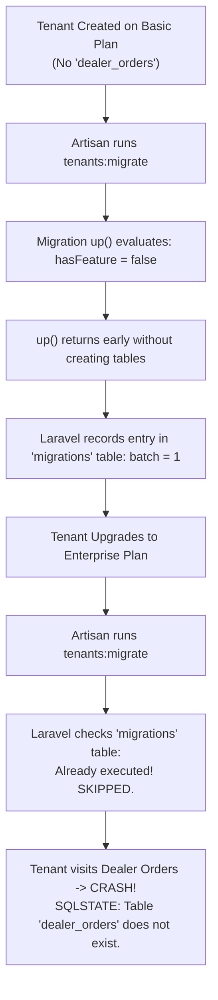
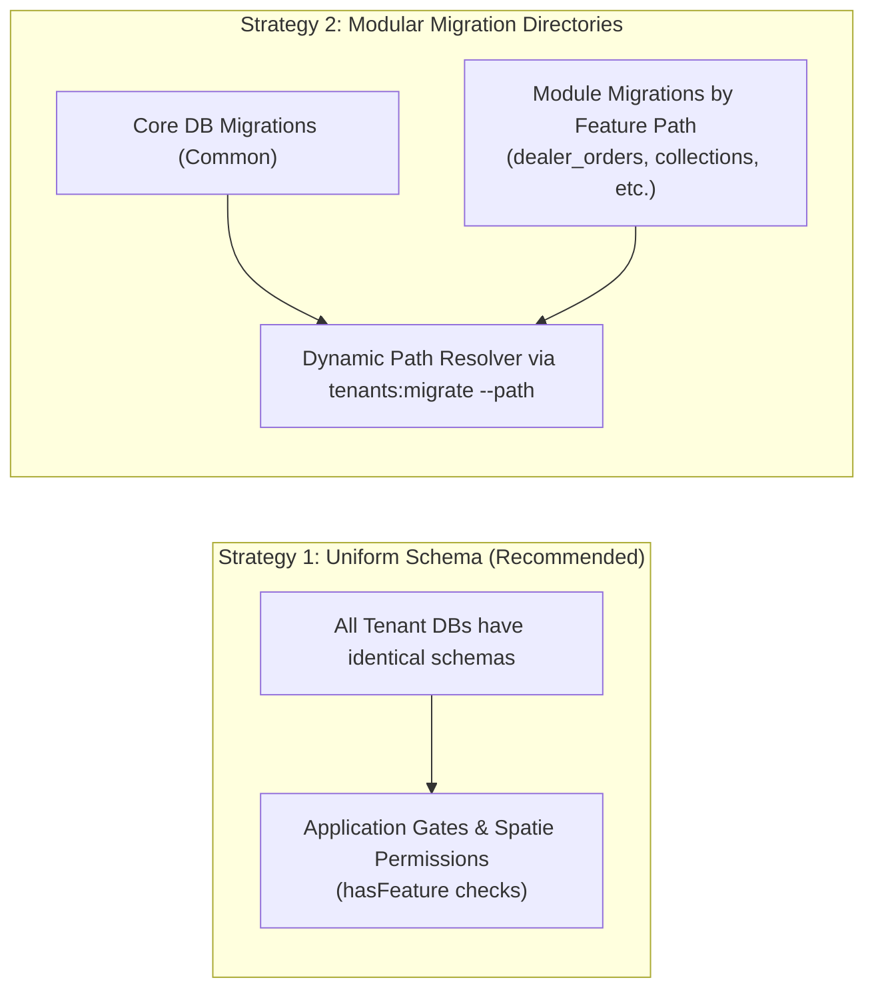
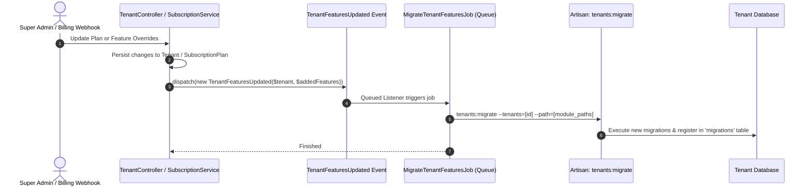

# Feature-Conditional Database Migrations Plan

**System:** FieldMA 2.0 Multi-Tenant SaaS  
**Architecture:** Stancl Tenancy v3 + Laravel 13  
**Status:** Architectural Proposal (Awaiting Approval)  
**Author:** Manoj Shrestha & Antigravity  

---

## 1. Executive Summary

In a multi-tenant SaaS application with tiered subscription plans (e.g. Basic, Pro, Enterprise) and dynamic feature modules (e.g. `dealer_orders`, `collections`, `schedules`), tenants should only have access to functionality granted by their subscription package.

This document outlines how to prevent or isolate database migrations for unprovided features, highlights the critical architectural pitfalls of conditional migrations in Laravel, and provides concrete, step-by-step plans for two distinct architectural solutions:
1. **Strategy 1 (SaaS Gold Standard):** Uniform Schema with Application-Level Feature Gating.
2. **Strategy 2 (Physical Table Isolation):** Modular Migration Directories with Dynamic Path Resolution.

---

## 2. The Critical Anti-Pattern: The "Early Return" Trap

Before designing conditional migrations, we must explicitly document what **must not** be done:

```php
// ❌ CRITICAL ANTI-PATTERN: DO NOT DO THIS
class CreateDealerOrdersTable extends Migration
{
    public function up(): void
    {
        $tenant = tenant();
        if (!$tenant || !$tenant->hasFeature('dealer_orders')) {
            return; // ⚠️ DANGEROUS!
        }

        Schema::create('dealer_orders', function (Blueprint $table) {
            $table->id();
            // ...
        });
    }
}
```

### Why This Breaks Multi-Tenant SaaS


When an early `return` occurs inside `up()`, Laravel considers the migration file successfully executed and inserts a row into the tenant database's `migrations` table. When the customer later upgrades their plan, Laravel refuses to re-run the file, leaving the tenant database permanently broken.

---

## 3. Comparison of Viable Architectural Strategies



| Dimension | Strategy 1: Uniform Schema *(Recommended)* | Strategy 2: Modular Migration Directories |
| :--- | :--- | :--- |
| **Concept** | All tenant DBs share the exact same tables; access is locked at the application layer. | Tables for optional features are physically omitted until purchased. |
| **Industry Adoption** | Used by Shopify, Stripe, Salesforce, GitHub. | Used by on-premise ERP platforms or specialized compliance environments. |
| **Upgrade Experience** | **Instant (0 ms)** — updating `subscription_plan_id` or `data['feature_overrides']` immediately unlocks the feature. | **Asynchronous / Queued** — must run database migrations during plan checkout. |
| **Downgrade Experience** | Safe — feature is disabled; customer historical data remains intact. | Complex — dropping tables destroys customer data; keeping tables causes schema drift. |
| **Schema Drift** | **Zero** — all tenant databases match 1:1. | **High** — different tenants have disparate table structures and migration batch numbers. |
| **Foreign Key Safety** | Clean relationships across all domain tables. | Risky — foreign keys to tables from other unpurchased modules cannot be declared. |
| **Storage Impact** | Negligible — empty relational tables consume < 100 KB of metadata in MySQL/PostgreSQL. | Saves negligible disk space (< 100 KB per tenant). |

---

## 4. Implementation Blueprint: Strategy 1 (Uniform Schema + Feature Gating)

This is the standard architecture for modern SaaS applications. Because FieldMA already implements `$tenant->hasFeature(...)` and dynamic remote package permissions in `Tenant.php`, this approach builds on top of your existing foundations.

### 4.1 How It Works
1. All migrations under `database/migrations/tenant` run when a tenant is provisioned.
2. Every tenant database has the complete database schema.
3. Access to tables, APIs, and views is restricted by:
   - Route Middleware: `EnsureFeatureIsEnabled:dealer_orders`
   - Spatie Permissions: Synced with `web_features` and `mobile_features`
   - Eloquent Query Scopes / Model Policies: Checking `$tenant->hasFeature(...)`

### 4.2 Advantages for FieldMA
- Zero downtime on plan upgrades.
- Tenant upgrades never fail due to database lock contention.
- CI/CD pipelines run standard `php artisan tenants:migrate` without complex path calculations.

---

## 5. Implementation Blueprint: Strategy 2 (Modular Migration Directories)

If your business or infrastructure requires that database tables **must physically not exist** unless the feature is provided, you must structure migrations into directory modules and pass the paths dynamically.

### 5.1 Directory Structure Restructuring

Reorganize `database/migrations/tenant/` into:

```
database/migrations/tenant/
├── core/
│   ├── 0001_01_01_000000_create_users_table.php
│   ├── 0001_01_01_000001_create_roles_table.php
│   ├── 0001_01_01_000002_create_settings_table.php
│   └── 0001_01_01_000003_create_clients_table.php
└── modules/
    ├── dealer_orders/
    │   ├── 2024_01_01_000010_create_dealer_orders_table.php
    │   └── 2024_01_01_000011_create_dealer_order_items_table.php
    ├── retailer_orders/
    │   └── 2024_01_01_000020_create_retailer_orders_table.php
    ├── collections/
    │   └── 2024_01_01_000030_create_collections_table.php
    ├── schedules/
    │   └── 2024_01_01_000040_create_schedules_table.php
    ├── chats/
    │   └── 2024_01_01_000050_create_chats_table.php
    ├── complaints/
    │   └── 2024_01_01_000060_create_complaints_table.php
    └── visits/
        └── 2024_01_01_000070_create_visits_table.php
```

Each folder name under `modules/` must match the canonical feature key defined in `config/features.php`.

---

### 5.2 Dynamic Migration Path Resolver Service

Create `app/Services/Tenancy/TenantMigrationManager.php`:

```php
namespace App\Services\Tenancy;

use App\Models\Tenant;

class TenantMigrationManager
{
    /**
     * Get all migration paths that apply to a specific tenant based on their active features.
     *
     * @return array<int, string>
     */
    public function getMigrationPathsForTenant(Tenant $tenant): array
    {
        $paths = [
            database_path('migrations/tenant/core'),
        ];

        $modulesBase = database_path('migrations/tenant/modules');

        foreach (array_keys(config('features.map', [])) as $featureKey) {
            if ($tenant->hasFeature($featureKey)) {
                $featurePath = $modulesBase . '/' . $featureKey;
                if (is_dir($featurePath)) {
                    $paths[] = $featurePath;
                }
            }
        }

        return $paths;
    }

    /**
     * Get migration paths for newly activated features only.
     *
     * @param array<int, string> $newFeatureKeys
     * @return array<int, string>
     */
    public function getPathsForFeatures(array $newFeatureKeys): array
    {
        $paths = [];
        $modulesBase = database_path('migrations/tenant/modules');

        foreach ($newFeatureKeys as $featureKey) {
            $featurePath = $modulesBase . '/' . $featureKey;
            if (is_dir($featurePath)) {
                $paths[] = $featurePath;
            }
        }

        return $paths;
    }
}
```

---

### 5.3 Provisioning: Migrating On Tenant Creation

In `TenantController::store()` and anywhere tenants are created, replace the static call:

```php
// BEFORE:
Artisan::call('tenants:migrate', [
    '--tenants' => [$tenant->id],
    '--force' => true,
]);

// AFTER:
$migrationManager = app(\App\Services\Tenancy\TenantMigrationManager::class);
$paths = $migrationManager->getMigrationPathsForTenant($tenant);

Artisan::call('tenants:migrate', [
    '--tenants' => [$tenant->id],
    '--path' => $paths,
    '--realpath' => true,
    '--force' => true,
]);
```

---

### 5.4 Subscription Upgrades & Incremental Migrations

When a tenant changes plans or a super-admin toggles an add-on feature:



#### The Incremental Job:
```php
namespace App\Jobs;

use App\Models\Tenant;
use App\Services\Tenancy\TenantMigrationManager;
use Illuminate\Bus\Queueable;
use Illuminate\Contracts\Queue\ShouldQueue;
use Illuminate\Foundation\Bus\Dispatchable;
use Illuminate\Queue\InteractsWithQueue;
use Illuminate\Queue\SerializesModels;
use Illuminate\Support\Facades\Artisan;

class MigrateTenantFeaturesJob implements ShouldQueue
{
    use Dispatchable, InteractsWithQueue, Queueable, SerializesModels;

    public function __construct(
        public Tenant $tenant,
        public array $addedFeatures
    ) {}

    public function handle(TenantMigrationManager $manager): void
    {
        $paths = $manager->getPathsForFeatures($this->addedFeatures);

        if (empty($paths)) {
            return;
        }

        Artisan::call('tenants:migrate', [
            '--tenants' => [$this->tenant->id],
            '--path' => $paths,
            '--realpath' => true,
            '--force' => true,
        ]);
    }
}
```

---

### 5.5 Handling Downgrades & Feature Deactivations

What happens when a tenant cancels or downgrades a feature?

> [!WARNING]
> **Data Loss Risk:** Never automatically run `migrate:rollback` or `DROP TABLE` when a tenant downgrades.  
> If an admin accidentally selects the wrong plan, dropping tables permanently wipes out the customer's historical orders, payments, or records.

**Recommended Downgrade Policy:**
1. Leave the physical tables intact.
2. Invalidate tenant cache and revoke the feature flag in `$tenant->data['feature_overrides']` or `subscription_plan_id`.
3. Application guards (`hasFeature()`) immediately block user access and API requests.
4. If the tenant renews or re-upgrades, access is instantly restored without data loss.

---

### 5.6 Foreign Key Constraint Rules for Modular Migrations

When migrations are split into separate feature folders, strict Foreign Key constraints between different modules can cause fatal migration errors:

* **Rule 1:** Module migrations can reference `core/` tables (e.g. `dealer_orders.client_id` -> `clients.id`).
* **Rule 2:** Module migrations must **never** reference tables in another optional module (e.g. `dealer_orders` must not have a strict DB foreign key to `inventory_items` if `inventory` is an independent module).
* **Rule 3:** Use logical relationships (`belongsTo` in Eloquent) with null checks or composite application validation instead of database-level foreign keys across modules.

---

## 6. Implementation Checklist

- [ ] Confirm chosen strategy (**Strategy 1** vs **Strategy 2**).
- [ ] If Strategy 2:
  - [ ] Audit all 119 existing files in `database/migrations/tenant` and classify into `core` vs `modules/{feature}`.
  - [ ] Audit foreign key constraints between modular tables.
  - [ ] Implement `TenantMigrationManager`.
  - [ ] Update `TenantController` and `ImportExistingTenantCommand` to use dynamic paths.
  - [ ] Implement `TenantFeaturesUpdated` event and `MigrateTenantFeaturesJob`.
  - [ ] Write automated tests validating:
    - New tenant created with Basic plan only gets core tables.
    - Tenant upgrade triggers background migration for module tables.
    - Subsequent `tenants:migrate` runs cleanly without duplicate table errors.
